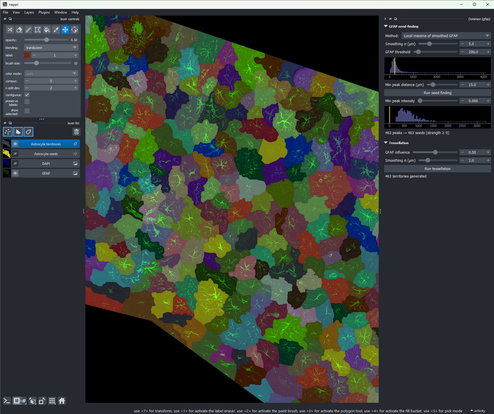

# DOMINION

**DOM**ain **I**dentification for **N**etworks of **I**mmunolabeled **O**bject **N**eighborhoods.

A napari-based workflow for quantitatively partitioning tissue into per-object
domains from 2D immunofluorescence images.



*DOMINION in `--mode signal` on an immunolabeled tissue section. Right: signal
seed-finding and tessellation submenus. Center: the napari viewer showing
watershed domains (one color per object) overlaid on the signal channel; here
462 detected peaks became 462 object domains.*

## What it does

Given an immunofluorescence image where one channel labels the objects of
interest (cells with intermediate-filament markers, membrane markers,
cytoplasmic markers, etc.), DOMINION partitions the tissue into a per-object
domain mask. Downstream you can:

- count objects per region,
- assign per-object intensities for any additional channel,
- extract per-object morphology metrics,
- describe neighbor relationships between objects.

The core idea is **tessellation**: many cell populations tile space with
limited overlap, but their full territories aren't visible in any single
immunolabel — most markers light up only the soma + main processes and miss
the fine peripheral structures that make up most of the cell. Direct
segmentation of the signal massively under-estimates territory. Tessellating
the tissue mask from identified object centers, using the signal intensity as
boundary evidence, is a more honest approximation.

Originally developed for astrocyte-domain analysis from GFAP + DAPI, but the
pipeline is signal-agnostic: any channel that brightens *at* the objects you
care about (and dims between them) is a valid input.

## Two pipeline modes

DOMINION ships with two pipelines that share a tessellation step.

### `--mode signal` (default): two-stage pipeline

```
[signal] -> find object centers directly -> seeded watershed on signal
```

1. **Signal seed-finding** — either local-maxima of the smoothed signal, or
   peaks of the distance transform of the thresholded signal. Each peak is
   taken as an object center.
2. **Tessellation** — signal-guided seeded watershed within the tissue mask,
   one domain per kept seed.

This is the default because the signal channel carries the object-specific
information directly. Fewer parameters, more direct biological interpretation.
Accepts either single-channel signal TIFFs or 2-channel CYX TIFFs (the
nuclei channel is just ignored in this mode).

Won't necessarily catch every object — anything with diffuse signal and no
clear soma peak gets under-counted. The distance-transform method is more
robust to that than local-maxima.

### `--mode nuclei`: three-stage pipeline

```
[nuclei] -> StarDist segmentation -> filter by signal context -> seeded watershed on signal
```

1. **Nuclei segmentation** — StarDist's `2D_versatile_fluo` model segments
   every nucleus in the nuclei channel.
2. **Object classification** — for each nucleus, compute a score from the
   surrounding signal (intensity within a disc, weighted by distance from the
   centroid). Threshold the score to select object seeds.
3. **Tessellation** — same as signal mode.

Best when the nuclei channel reliably identifies your objects (rarely the
case in mixed-population tissue) and you want per-nucleus tracking through
the pipeline. Requires a 2-channel CYX TIFF (signal=channel 0, nuclei=channel 1).

## Installation

DOMINION comes in two flavours:

- **Basic** — the default signal-mode pipeline. No GPU, no TensorFlow; runs on
  any modern Windows PC.
- **Full** — Basic *plus* StarDist nuclei detection (`--mode nuclei`). Adds
  TensorFlow 2.10 and works best with an NVIDIA GPU (CPU works but StarDist is
  then minutes, not seconds). TensorFlow 2.10 is the last native-Windows build
  with CUDA support, which is why Full is locked to Python 3.10.

### Easy install (Windows — recommended)

No prior Python, conda, or git knowledge needed.

1. Download the project: on GitHub click **Code ▸ Download ZIP**, then
   right-click the ZIP ▸ **Extract All**.
2. Open the extracted folder, then the **`installers`** folder.
3. Double-click one of:
   - **`Install DOMINION (Basic).bat`** — easy, no GPU.
   - **`Install DOMINION (Full).bat`** — adds AI nuclei detection.
4. Let it finish. If conda isn't already on your PC, the installer downloads a
   small copy (Miniforge) for you — nothing else to set up.
5. A **DOMINION** icon appears on your Desktop. Double-click it to start.

To update later, double-click **`Update DOMINION.bat`**. To switch between
Basic and Full, just run the other installer.

### Manual install (advanced)

Run these from the extracted project folder (the one containing
`pyproject.toml`), in a PowerShell terminal.

**Basic:**

```powershell
conda create -n dominion python=3.11 -y
conda activate dominion
pip install .
```

**Full** (StarDist / nuclei mode):

```powershell
conda create -n dominion python=3.10 "tensorflow=2.10.0=gpu_py310*" -c defaults -y
conda activate dominion
pip install ".[nuclei]"

# napari may install PyQt6, whose DLLs fail to load on some Windows machines
# ("QtBindingsNotFoundError"). If that happens, swap to PyQt5:
pip uninstall -y PyQt6 PyQt6-Qt6 PyQt6-sip
pip install PyQt5
```

For a CPU-only Full install, replace the `tensorflow=2.10.0=gpu_py310*` spec
with `tensorflow=2.10.0`.

## Usage

Easiest: double-click the **DOMINION** Desktop icon (or
`installers\Launch DOMINION.bat`). A file-open dialog asks you to pick an
image, and the app opens in signal mode.

From a terminal, in the `dominion` environment:

```powershell
dominion                                       # pick an image via dialog (signal mode)
dominion C:\path\to\image.tif                  # signal mode on a specific file
dominion C:\path\to\image.tif --mode nuclei    # nuclei mode (Full install only)
```

(The older `python scripts\run_dominion.py <image>` form still works too.)

Accepted input formats:

- **Single-channel 2D TIFF** — treated as the signal channel. Works in signal
  mode only.
- **2-channel CYX TIFF** — channel 0 = signal, channel 1 = nuclei. Works in
  both modes.

Non-tissue pixels are expected to be zero (the tissue mask is derived from the
non-zero footprint of the available channels). Pre-mask non-tissue before
loading.

Pixel size is read from the TIFF resolution metadata (ImageJ convention:
`unit=µm`, `XResolution` in pixels/µm). If missing, the pipeline falls back
to 1.0 µm/pixel with a warning — fine for tuning but means slider radii in µm
don't reflect real distance.

### Working in the napari dock

Each stage has its own collapsible section with a **Run** button. Downstream
stages enable when upstream produces a result but don't auto-recompute — you
explicitly Run each step. This avoids wasting compute when tuning upstream
sliders.

One exception: the live re-filter sliders stay reactive — **θ (seed threshold)**
in nuclei mode's classification step and **peak strength** in signal mode's
seed-finding step. Both just re-filter cached results and update instantly.

When a stage's parameters change, downstream stages keep their visualization
(stale, for comparison) but their label warns you to click Run.

### Adjusting point sizes

The "Object seeds" layer uses uniform point size, so napari's built-in
**point size** slider in the layer controls works on all points at once. The
size persists through Run / θ / peak-strength tweaks (only resets when you
re-run nuclei detection with a different number of detections).

## Caching

Each image gets a sibling cache directory: `image.tif → image.dominion_cache_<hash>/`.
The hash is the first 8 chars of the image's MD5, so re-running on the same
file is a cache hit; modifying the file invalidates the cache automatically.

Currently only StarDist nuclei outputs are cached (the only slow recomputation
in the nuclei pipeline). Cache directories are git-ignored via `*.dominion_cache_*/`.

## Architecture

```
src/dominion/
  types.py                       # ImageData, NucleiResult, SeedsResult,
                                 # TessellationResult dataclasses
  state.py                       # AppState with subscribe/notify, downstream-clear
  io.py                          # TIFF loading, pixel-size parsing, tissue mask
  cache.py                       # per-image cache directory + npz load/save
  seedfind.py                    # pure signal-only seed-finding algorithms
  app.py                         # build_dock_widget(state, viewer, mode='signal')
  cli.py                         # launch entry point: args/file-dialog -> napari
  capabilities.py                # detects the optional StarDist/TF (Full) stack
  widgets/common.py              # NumericSlider, HistogramSlider, CollapsibleSection
  submenu1_nuclei.py             # nuclei mode stage 1: StarDist nuclei
  submenu2_seeds.py              # nuclei mode stage 2: signal-based classification
  submenu3_tessellation.py       # both modes: signal-guided watershed
  submenu_a_signal_seeds.py      # signal mode stage 1: direct peak-finding
scripts/
  run_dominion.py                # thin wrapper around dominion.cli:main
installers/
  Install DOMINION (Basic|Full).bat, Launch/Update .bat + .ps1 scripts
```

State flows along a fixed chain: `image → nuclei → seeds → tessellation`.
Setting any slot clears all downstream slots and notifies subscribers. Submenus
subscribe to the slot they consume; downstream submenus re-enable but don't
auto-recompute. The chain is identical in both modes — signal mode just
populates `nuclei` with synthetic centroids (the peak coordinates) and
`seeds` with all indices kept.

`app.build_dock_widget(state, viewer, mode=...)` is the future-plugin entry
point. The CLI module (`dominion/cli.py`) is the only filesystem
consumer; everything else takes pre-loaded `ImageData` via `AppState`. A
future napari plugin would call `build_dock_widget` directly.

## Limitations / what's not in this version

- **2D only.** Z-stacks are not handled; results from a single z-plane are
  cross-sections through 3D object domains, not full domains.
- **No ground-truth validation.** No sparse-label or hand-annotated comparison
  is built in. Quality is judged by visual inspection of the napari overlay
  and internal sanity checks (domain count, sizes, no leakage outside tissue).
- **No batch mode.** One image per invocation; parameters must be tuned in the
  GUI per image. Saving and reloading slider state is a logical next step but
  not implemented.
- **No quantitative export yet.** The pipeline produces `state.tessellation`
  with per-object domain labels, but no CSV/feature table of per-domain
  metrics is written to disk. Easy to add — `regionprops_table` on the domain
  mask gets you area, centroid, intensity stats per object.
- **StarDist needs sensible nucleus scale (nuclei mode only).** Native model
  expects nuclei of ~10–30 px diameter. If your image's pixel size leaves
  nuclei at ~3 px (typical for low-mag tissue overviews), upscale before
  loading or accept noisier nuclei segmentation.
- **TF 2.10 on Windows is frozen at 2022.** GPU StarDist on native Windows
  uses the last TF version with Windows CUDA support. For new TF features or
  active maintenance, run inside WSL2 with current TF.
- **Diffuse signal misses objects.** Local-maxima seed-finding fails on cells
  whose signal is broad and lacks a clear peak (e.g. reactive astrocytes in
  injury models). The distance-transform method is more robust but still
  threshold-dependent.

## License

See repository.
